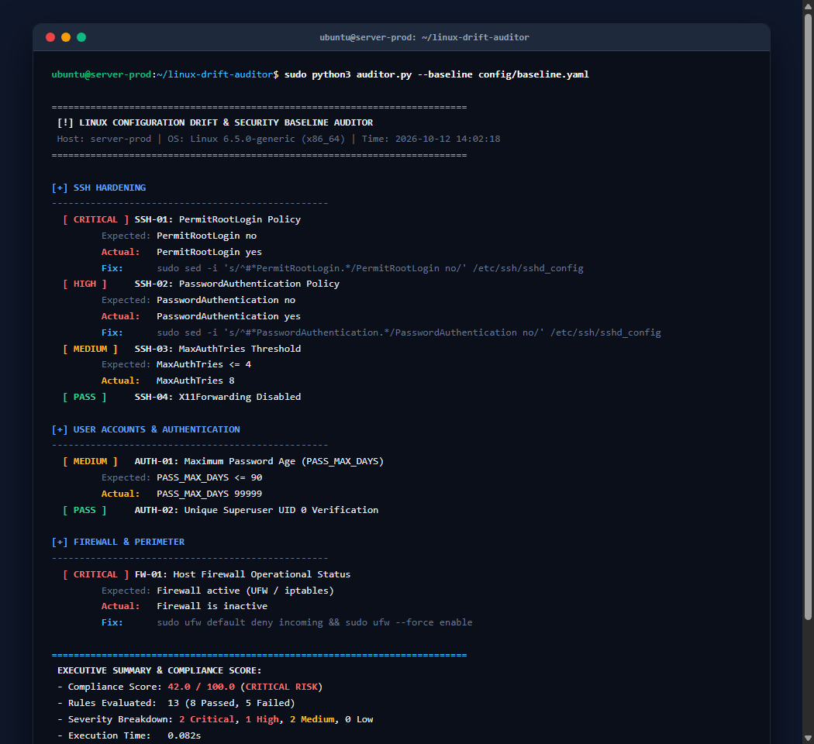
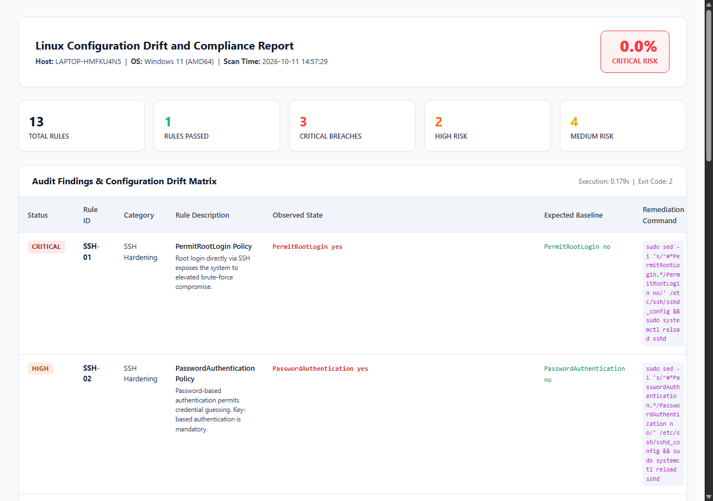

# linux-drift-auditor

[](https://github.com/ferdianhanif/linux-drift-auditor/actions/workflows/ci.yml)
[](LICENSE)
[](https://www.python.org/downloads/)

A lightweight configuration compliance and security drift auditor for Linux systems.

## Overview

Linux servers often drift from their intended security baseline over time. An administrator might temporarily change an SSH setting, disable a firewall rule, or leave a port listening during troubleshooting and forget to revert it.

Tools like OpenSCAP and Lynis provide thorough system audits, but their output is often too dense for daily automated checks or CI/CD pipelines.

`linux-drift-auditor` is designed to run fast. It inspects local system state and compares it against a declarative YAML policy in under 0.2 seconds. It returns standard exit codes (0 for clean, 1 for warning, 2 for critical failure), generates an optional remediation script, and can send alerts to Telegram or produce a self-contained HTML report.

## Features

- Fast execution: Runs directly on the host using native file parsing and kernel interfaces (`/proc/net/tcp`).
- Policy as code: Reads target rules from a simple YAML file (`config/baseline.yaml`).
- Standard exit codes: Easy to wire into cron jobs, shell scripts, or CI/CD deployment checks.
- Non-destructive: Audits read-only state. Remediation commands are written to a standalone script (`remediate.sh`) for manual review.
- Offline reporting: Generates a single-file HTML report with zero external CDN dependencies.
- Telegram integration: Sends a concise summary and attaches the HTML report if configured.

## Architecture

```
[config/baseline.yaml] ---> [DriftAuditorEngine] <--- [Live System Files / Kernel]
                                  |
         +------------------------+------------------------+
         |                        |                        |
[Terminal Exit Code]     [remediate.sh Script]     [HTML Report & Telegram]
(0 Clean / 1 Warn / 2 Fail)
```

## Previews

### Terminal Output


### Standalone HTML Report


## Checks Performed

### SSH Configuration (`/etc/ssh/sshd_config` and drop-ins)
- Root login policy (`PermitRootLogin`)
- Password authentication policy (`PasswordAuthentication`)
- Authentication attempt limits (`MaxAuthTries`)
- Idle session timeouts (`ClientAliveInterval`)
- X11 forwarding status (`X11Forwarding`)

### User and Password Policy
- Password age limits in `/etc/login.defs` (`PASS_MAX_DAYS`, `PASS_MIN_DAYS`)
- Unique UID 0 verification in `/etc/passwd` (flags rogue accounts)
- Empty password hash verification in `/etc/shadow`

### Firewall and Network Surface
- Host firewall status (UFW / iptables)
- Listening TCP sockets checked against an allowed port whitelist

### Filesystem Permissions
- World-writable files in `/etc`
- SUID binaries in temporary locations (`/tmp`, `/var/tmp`, `/dev/shm`)

## Installation and Requirements

- Linux (tested on Ubuntu 20.04/22.04/24.04 and Debian 11/12)
- Python 3.8+
- PyYAML

```bash
git clone https://github.com/ferdianhanif/linux-drift-auditor.git
cd linux-drift-auditor
pip install pyyaml
```

## Usage

Run an audit against the default baseline:

```bash
sudo python3 auditor.py
```

### CLI Arguments

```text
--baseline, -b   Path to baseline YAML policy (default: config/baseline.yaml)
--root, -r       Root directory to inspect (useful for chroot or testing)
--remediate-out  Path for the generated remediation script (default: remediate.sh)
--html           Path to save the standalone HTML report
--telegram       Send alert via Telegram bot (requires environment variables)
```

### Exit Codes

- `0`: All checks passed.
- `1`: Warning or medium/low severity findings detected.
- `2`: Critical or high severity findings detected.
- `3`: Engine execution error.

### Example: Daily Cron

Add a daily check in `/etc/cron.daily/drift-auditor`:

```bash
#!/bin/sh
/usr/bin/python3 /opt/linux-drift-auditor/auditor.py \
  --baseline /opt/linux-drift-auditor/config/baseline.yaml \
  --html /var/log/security-audit-latest.html \
  --telegram >> /var/log/drift-auditor.log 2>&1
```

### Example: Telegram Configuration

Set the environment variables before running:

```bash
export TELEGRAM_BOT_TOKEN="your_bot_token"
export TELEGRAM_CHAT_ID="your_chat_id"
sudo -E python3 auditor.py --telegram
```

## Remediation

When failures are detected, the auditor generates a bash script with suggested fix commands. Inspect the script before running it:

```bash
cat remediate.sh
sudo bash remediate.sh
```

## License

MIT License. See [LICENSE](LICENSE) for details.
